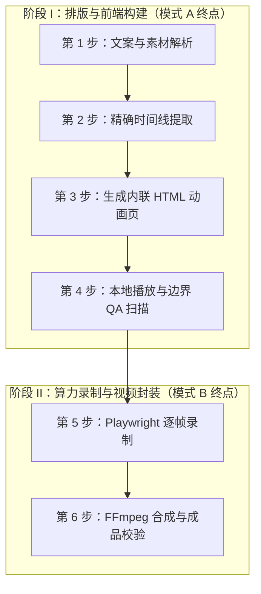

# VIBE 知识视频制作技能（SKILL）

## 0. 交付模式决策与前置交互规范（重要）

本技能支持两种交付模式，有效解耦“智能编排”与“重型算力渲染”：

| 模式 | 交付成果 | 适用场景 | 预期耗时 |
| :--- | :--- | :--- | :--- |
| **模式 A：轻量模式（仅生成 HTML 页面）** | 自包含 `.html` 文件（全内联）+ 安全区 QA 报告 | 文案打磨、排版预览、卡点校验、准备导入外部本地软件离线渲染 | **5 ~ 15 秒**（秒级反馈） |
| **模式 B：完整模式（直接生成 MP4 视频）** | 最终 1080×1920 `.mp4` 视频 + 质检报告 | 文案已定稿、需要全自动一条龙直接出片 | **1 ~ 5 分钟**（CPU/GPU密集渲染） |

### 意图识别与询问决策逻辑：
1. **显式指定时**：
   - 用户明确提及“只生成网页”、“生成HTML”、“预览页面”、“页面排版” $\rightarrow$ **执行模式 A**。
   - 用户明确提及“直接生成视频”、“导出MP4”、“做成视频成品” $\rightarrow$ **执行模式 B**。
2. **未指定交付方式时（强制主动交互）**：
   - 若用户仅提供了文案、音频和时间戳，未明确说明是生成网页还是视频，**严禁私自启动耗时漫长的 Playwright 录制与 FFmpeg 合成**。
   - Agent **必须先向用户发起询问确认**，推荐以快速生成 HTML 优先。询问范例如下：
     > “已为您解析素材！请问本次制作的交付偏好是：
     > 1. **(推荐) 快速生成 HTML 动画页**：秒级生成，可直接在浏览器全屏预览动画与字级卡点，确认满意后再一键转视频或导入本地软件。
     > 2. **直接生成完整 MP4 视频**：全自动完成逐帧无头录制与 FFmpeg 混流，直接输出最终视频文件。”

---

## 1. 技能概述与认知对齐

- **核心定位**：面向抖音竖屏（9:16，1080×1920）「VIBE 知识大赏」类知识科普视频的标准生产流水线。核心产物为自包含单文件 HTML 动画页（原生 JS + CSS 动画，数据全内联），经 Playwright 逐帧无头截图后由 FFmpeg 合成最终 MP4。
- **认知对齐（严禁做错）**：
  - **这不是 AI 文生视频**，而是代码可控精准渲染。
  - 核心要求：**画面精确对应讲解内容、字幕逐字同步、信息密度高、四边避让平台 UI**。
- **规则单一事实源（SSOT）**：
  制作前**必须先完整读取 [vibe-rules.md](../../rules/vibe-rules.md)**，所有四边安全区尺寸、三区净空推导、字幕断句三原则、行末标点过滤与图案化表达铁律以 `vibe-rules.md` 为唯一准绳。

---

## 2. 技能包自包含资产库

本技能是自包含的独立技能包，内部集成了全套生产资料：
1. **[vibe-rules.md](../../rules/vibe-rules.md)** —— 制作规范与硬性约束（决策表/铁律/交付自查）；
2. **模板家族（必须以其为底稿修改，禁止从零手写）**：
   - **[templates/skeleton.html](./templates/skeleton.html)** —— **机理科普核心模板**（内置多阶段开场、SVG 环形图、双列对比卡、三区安全约束与卡拉OK字幕引擎）；
   - **[templates/skeleton-timeline.html](./templates/skeleton-timeline.html)** —— **历史演进/大事记特化模板**（内置垂直贯穿时间主轴与节点渐进点亮动效）；
3. **[examples/N0001_star_strain/](./examples/N0001_star_strain/)** —— 官方定稿示范案例（参考其实战复杂场景实现）；
4. **[assets/](./assets/)** —— 物理资产库：包含 [motions.css](./assets/motions/motions.css)（动效）、[icons/](./assets/icons/)（SVG 图形）、[themes.css](./assets/themes/themes.css)（配色主题）、[sfx_presets.json](./assets/sounds/sfx_presets.json)（音效配方）；
5. **[references/](./references/)** —— 深度技术参考（technical-details / pitfalls / checklist）；
6. **统一工具链 CLI** —— 在项目根目录执行 `python vibe.py`（内置 doctor / timeline / storyboard / check / qa / audit / bg / preview / render / mux / verify）。

---

## 3. 标准生产流程（两阶段架构）



### 【阶段 I：排版与前端构建】

#### 第 1 步：文案与素材解析
- 输入：外部已有工程文件夹（如 `c:\vibe测试\N0001\`）或 `projects/{作品}/` 下的 `script.txt`（文案）、`voice.wav`（配音）、`char_timestamps.json`（字级时间戳）。
- 逻辑切分：依据文案语义段落与论点切分场景（每个论点 1 个场景），识别开场形态（钩子型/直奔主题/系列回顾）与结尾 CTA。

#### 第 2 步：精确时间线提取
- 执行命令：
  ```bash
  python vibe.py timeline <时间戳JSON> <关键词txt> -o <输出txt> [--sfx-out <sfx.json>]
  ```
- **铁律**：所有场景边界、开场相位、关键数据强调点、音效触发点均来自字级时间戳，**严禁估算**。关键词打上业务标签（如 `3.5倍|数据`、`真相|重点`）可自动生成标准 `sfx.json`。

#### 第 3 步：生成 HTML 动画页
- 复制 [templates/skeleton.html](./templates/skeleton.html) 至外部输入工程目录（就地赋能）或 `projects/{作品编号}_{作品名称}/{作品编号}_{作品名称}.html`。
- 将文案、时间戳数组、场景列表内联入 JavaScript，并在中区构建多波次入场（`wIn`, `w2`, `w3`）的场景节点与 SVG 图示。
- **排版硬性约束**：
  - **画面顶部纯粹作品标题（Clean & Striking Header）**：画面顶部可显示区域**只显示作品标题**，严禁堆叠分镜头胶囊、小节标签或左上角 HUD 微标；文字较少（短标题，≤12字）显示成 1 行（4.0~4.5cqw），文字较多（长标题，>12字）根据语义自然断句显示成 2 行（主标题 3.8~4.2cqw + 副标题 3.2~3.6cqw）；采用文字发光微渐变与轻透悬浮拟态底衬包装，确保视觉美观、清晰、醒目；
  - **竖屏垂直优先（Vertical Stacking First）**：多条要点或对比卡片必须优先使用上下纵向堆叠大卡片（`card-stack`，宽 82cqw，标题 3.8~4.2cqw，正文 2.8~3.2cqw），饱满利用 9:16 纵向空间，严禁左右小卡片挤压文字；
  - **黄金 3 秒高频爆点（Golden 3-Second Hook）**：开场镜头必须设置多阶段递进动效（0~1.5s 痛点悬念冲撞 → 1.5~4.0s 主角强力亮相），严禁首屏静态呆立超过 1.5 秒；
  - **高品质粒子背景动效（High-Impact Particle Background）**：严禁使用稀疏暗淡的简单微粒。必须套用官方背景预设库（运行 `python vibe.py bg` 可唤起交互画廊预览），按题材匹配：
    - `bio-bubbles`：深海/微生物细胞浮游光斑（生物、医药、农业首选）；
    - `constellation`：神经元/量子星图能量网（AI、脑科学、物理前沿）；
    - `dna-spiral`：双螺旋基因粒子流（合成生物、基因编辑、分子生命）；
    - `cyber-grid`：3D 赛博透视网格（算力、芯片、区块链、工业互联网）；
    - `aurora-dust`：双核极光漫射与星尘（宏观科普、天文航天、自然地理）。
- 保证数据全内联（file:// 协议下禁止 fetch 本地外部文件）。页面内置 `VibeSound` 原生音效引擎，场景推进自动播放 whoosh，结尾 CTA 自动播放 chime。微动效仅可按需调用白名单音效（`pop` / `ding` / `click`）。

#### 第 4 步：本地播放、边界 QA 与全维度质量复核门禁
- 执行播放与场景推进检测：
  ```bash
  python vibe.py check <工程目录或HTML路径>
  ```
- 执行全维度质量复核与图数碰撞检测门禁（必跑）：
  ```bash
  python vibe.py audit <工程目录或HTML路径>
  ```
- **复核自愈闭环**：
  - `audit` 自动审查：图数与图文物理重叠碰撞（0 穿透）、四边安全区（0 越界）、移动端字号可读性（正文 ≥ 2.8cqw）、竖屏垂直堆叠排版、开场黄金 3 秒高频爆点。
  - **若复核存在任何报错，严禁交付给用户！** 必须自动修复代码并重新执行 `audit`，直至 100% 绿灯（0 违规）后方可交付。

> **🌟 模式 A（轻量模式）交付节点（推荐）**：
> 到此步骤即完成模式 A。
> 1. **独立工程包归集**：确保该作品独立文件夹（外部输入目录，或 `projects/{作品编号}_{作品名称}/`）内，完整齐备 5 核心文件：
>    - 核心网页：`{作品}.html`
>    - 主配音：`{作品}.wav` 或 `voice.wav`
>    - 时间戳：`*_char_timestamps.json`
>    - 文案脚本：`*.txt` 或 `script.txt`
>    - 音效配置：`sfx.json`
> 2. 向用户汇报 QA 通过结果，输出独立工程目录路径；
> 3. 用户可将此独立工程文件夹直接拖拽入 **WeMediaForge 桌面端【基础工具箱 - 网页处理】**，调用本地 GPU 硬件加速极速生成 MP4，无需在命令行中启动繁重的无头录制。

---

### 【阶段 II：算力录制与视频封装】（模式 B 或后续渲染触发）

#### 第 5 步：Playwright 逐帧录制
- 启动逐帧截图（默认 20fps，过程帧强制隔离输出至 `temp/frames/{作品}/`）：
  ```bash
  python vibe.py render <工程目录/HTML路径> temp/frames/{作品} <时长秒> --fps 20
  ```
- 若时长 >5 分钟，支持通过 `--start` 和 `--stop` 分段渲染与断点续跑。

#### 第 6 步：FFmpeg 合成与交付验证
- 合成 MP4（人声配音 + 独立音效轨 amix 混音，缺省 `--sfx` 时自动从 HTML 解析场景挂载音效）：
  ```bash
  python vibe.py mux temp/frames/{作品} <配音WAV路径> <输出MP4路径> <时长秒> [--sfx <音效表json>]
  ```
- 媒体规格与音量探针校验：
  ```bash
  python vibe.py verify <输出MP4路径> --frames temp/frames/{作品}
  ```
- 交付最终成品：工程目录下的 `.html` 与 `.mp4` 文件。

---

## 4. 交付结果标准模板

### 模式 A 交付范例：
```markdown
✅ **HTML 动画页已制作完成并通过安全区 QA！**
- **工程目录路径**：`[点击打开工程目录](file:///D:/vibe-video-studio/projects/N0002_xxx/)`
- **网页文件**：`N0002_xxx.html`
- **即时预览**：可在浏览器中双击直接打开，支持全屏播放与逐字高亮卡点检查。
- **后续极速出片建议**：
  直接将整个工程文件夹拖入 **WeMediaForge【基础工具箱 - 网页处理】**，调用本地 GPU 硬件加速秒级生成高清 MP4！
```
